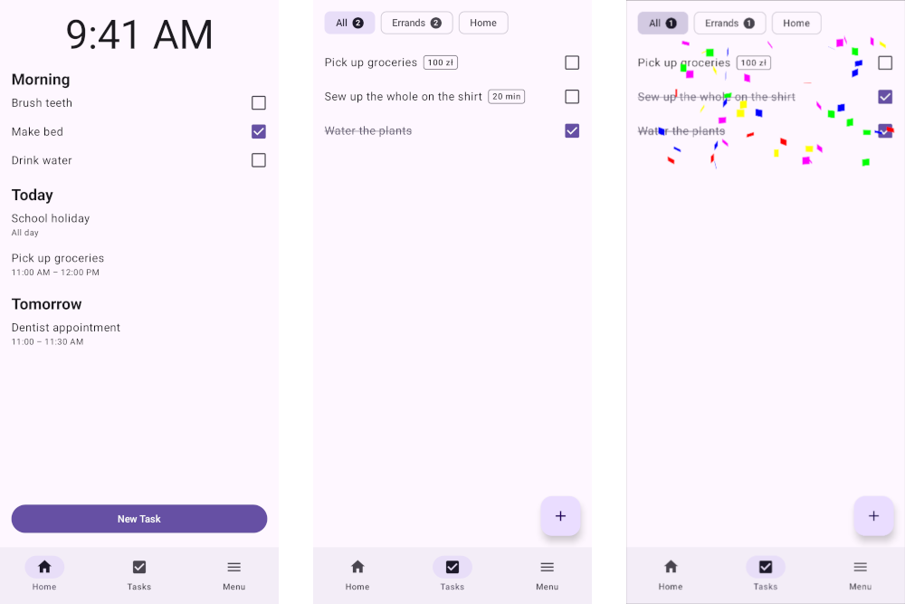

# Medus — Personal Assistant

Minimalistic personal assistant app that holds your important tasks and keeps them visible, so that 
nothing gets forgotten.

This is the app I _actually use_ every day to keep track of things I want and/or need to do.

## Features

- Home page with today's agenda
- Daily morning routine checklist
- Task tracker with tasks separated by areas
- Optional time and price estimates for tasks
- Confetti when completing a task
- Undo prompt to revert after a misclick

## Name

The name Medus comes from the book Lingua Latina Per Se Illustrata, where in one of the chapters
Medus was the servant who stole his master's money, leaving his bag almost empty. With a twist,
Medus the app "steals" all your taks, keeping them in its "bag", freeing space in your head.
